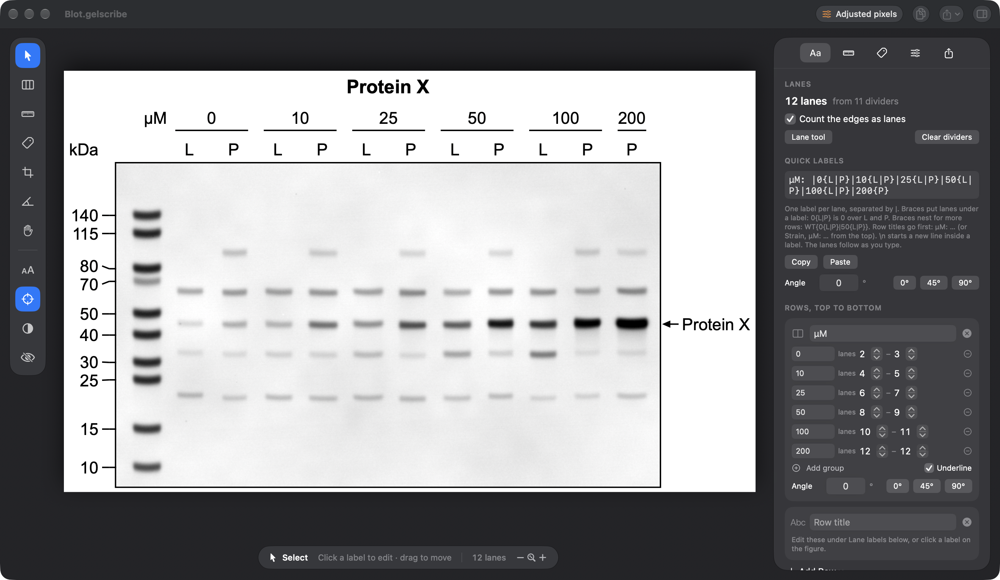

# GelScribe

GelScribe makes labeled figures from gel and western blots. You mark the lanes, type the lane labels, click the
ladder bands and name the bands you care about. It lays out the figure and exports it as PDF, TIFF, PNG or SVG.

The gel goes into the figure exactly as it was scanned: same pixel values, same bit depth and color space, nothing
resampled. You can turn that off to straighten a scan or apply brightness and contrast, and the exported file then
records what was done.




## Download

**Mac** (macOS 26 or later, Apple silicon): download `GelScribe.dmg` from [Releases](../../releases), open it and
drag GelScribe into Applications (or download `GelScribe.zip` and unzip it). The app isn't notarized, so macOS blocks the first launch. Open it once, then go to
System Settings › Privacy & Security and click Open Anyway.
If macOS says GelScribe "is damaged and can't be opened", it isn't: that's how recent macOS reacts to downloaded
apps that aren't notarized. Run this once in Terminal, then open it as usual:

```bash
xattr -dr com.apple.quarantine /Applications/GelScribe.app
```

**Windows**: download `GelScribe-Windows.zip` from [Releases](../../releases) when it's there, unzip it and run
`GelScribe.exe`. There's nothing to install. Windows SmartScreen shows "Windows protected your PC" the first time,
because the program isn't signed: click More info › Run anyway. `gelscribe-cli.exe` in the same folder is the
[command-line tool](#command-line).

**Linux, Intel or older Macs, and Windows without the zip**: use the Python version, which has the same tools and reads the same
project files. There's nothing to install from here: on this page click Code › Download ZIP, unzip it, and open the
`python` folder. Then open `GelScribe.bat` on Windows, `GelScribe.command` on a Mac or `GelScribe.sh` on Linux
(Python 3.11 to 3.14). [Setting up the Python version](#setting-up-the-python-version).

GelScribe checks GitHub once a day for a newer release and offers a link to it. It sends nothing but that request,
and you can turn it off in Settings.

## How it works

The [tutorial](docs/tutorial.md) goes through one blot from scan to figure, with a screenshot for each step. The
example image is in `docs/`, so you can follow along. The short version:

1. Drop a PNG, TIFF or JPEG on the window (the Mac app also opens HEIC). Color images stay in color. 32-bit and CMYK
   images are not supported.
2. Press L and click once in each gap between lanes.
3. Type the lane labels into Quick labels in the Aa tab, for example `µM: |0{L|P}|10{L|P}|25{L|P}`, or enter them
   one at a time in the fields below it.
4. Pick your ladder in the Ladder tab, press K and click the ladder bands from the top.
5. Press N and click a band to name it.
6. Export from the Export tab or the Export menu.

Every change can be undone, and the original image file is never modified. GelScribe opens in dark mode by default; View ›
Appearance switches it to light mode.

## What GelScribe doesn't do

GelScribe doesn't quantify bands.

## Multi-gel figures

A figure can stack more than one scan under the same lanes: the pieces of a membrane cut to probe different
antibodies, or a loading control blotted from a second gel of the same samples. Start with one gel, then File › Add
Gel… puts the next one underneath with a line between them (black, white or any color, at any thickness). GelScribe
finds each gel's lanes and lines them up with the first gel's. A switcher above the canvas shows the whole figure or one
gel on its own, and the tools work on the gel that is chosen. Each gel keeps its own crop (on all four sides),
brightness and contrast, rotation, ladder ticks, band names and Keep original pixels switch. You can move any gel by
hand or drag the gels into another order, and you can drop several images on an empty window to start with all of them.
Gels can also sit side by side, for example separately run radioactive gels: each gel then has its own lanes, one row
of lane labels runs across all of them, and GelScribe lines them up by their ladder bands and sizes them to match.
The [tutorial for multi-gel figures](docs/multi-gel.md) starts with how to scan and export the pieces, then goes through
a membrane cut in two.

## Label notation

Lane labels are one line of text with one entry per lane, separated by `|`. Braces put lanes under a shared label,
which adds a row above the lane labels.

| Typed | Result |
|---|---|
| `A\|B\|C` | Three lanes labeled A, B and C. |
| `0{L\|P}\|10{L\|P}` | 0 over the first two lanes and 10 over the next two, with L and P on each pair. |
| `µM: \|0{L\|P}\|10{L\|P}` | The same, with lane 1 (the ladder) left blank and the row titled µM. |
| `WT{0{L\|P}\|10{L\|P}}\|KO{0{L\|P}\|10{L\|P}}` | Braces nest: three rows, with WT and KO on top. |
| `Strain, µM: WT{…}\|KO{…}` | Titles for two rows, top row first. |
| `GFP\nonly` | `\n` starts a second line inside a label. |

You can type the labels before or after placing the lanes, and change them later in the Aa tab or by clicking a label
on the figure.

Lane labels can be turned to any angle with Angle, under Quick labels in the Aa tab (the 0°, 45° and 90° buttons are
there too), so long ones don't run into each other. Group labels, the ones over several lanes, have their own Angle in
their row's card, and their underline stays level. On the command line these are `--label-angle` and `--group-angle`.

## Keep original pixels (Strict mode)

Every new project starts with Keep original pixels on, which the command line calls Strict. The exported gel then has
the scan's original values, bit depth and color space, never resampled. Cropping is allowed, since it only selects
pixels. Brightness and contrast still work but change only the screen, as in ImageJ before you press Apply.

Turn it off in the Figure tab, under Original image, when you need to rotate the scan, fill the corners a rotation
uncovers, stretch a gel into line with another, or put a display range into the exported figure. GelScribe asks before
doing any of these while it's on. Each export then carries a note saying what was changed (rotation, display range,
crop, stretch), which ladder was used, and the SHA-256 of the original image.

In a multi-gel figure, each gel has its own switch. A gel you add starts with it off, so it can be stretched into line.
The toolbar badge reads Original pixels when every gel keeps its pixels, Adjusted pixels when none does, and Mixed
otherwise. The gels that keep their pixels have to be stored the same way, with the same bit depth and color.

## Keyboard shortcuts

Tools take a single key: V Select, L Lane Dividers, K Ladder Ticks, N Band Names, C Crop, R Straighten, H Pan.

| Command | Mac | Windows, Linux |
|---|---|---|
| Export PDF | ⌘E | Ctrl+E |
| Copy Figure | ⇧⌘C | Ctrl+Shift+C |
| New Gel with These Labels | ⇧⌘N | Ctrl+Shift+N |
| Copy Labels, Paste Labels | ⌥⌘C, ⌥⌘V | Ctrl+Alt+C, Ctrl+Alt+V |
| Paste Labels and Positions | ⌥⇧⌘V | Ctrl+Alt+Shift+V |
| Bigger Text, Smaller Text | ⇧⌘=, ⇧⌘− | Ctrl+Shift+=, Ctrl+Shift+- |
| Zoom to Fit, Actual Pixels | ⌘0, ⌘1 | Ctrl+0, Ctrl+1 |
| Zoom In, Zoom Out | ⌘+, ⌘− | Ctrl+=, Ctrl+- |
| Show or Hide Guides | ⌘' | Ctrl+' |
| Show or Hide Inspector | ⌥⌘I | Ctrl+Alt+I |
| Brightness & Contrast | ⇧⌘B | Ctrl+Shift+B |

Hold Space and drag, or scroll, to pan. ⌘-scroll (Ctrl-scroll on Windows and Linux) or pinch to zoom. Return finishes a
crop and Esc cancels. The tool keys and menu shortcuts can be changed in Settings › Shortcuts in the Mac app (⌘,) and
in Edit › Settings… in the Python version.

## Project files

A project is a folder ending in `.gelscribe` that holds `project.json` and a copy of the original image (and of
each stacked gel's image). If two gels have the same file name, the second copy is saved as `name_1.png`, the next as
`name_2.png`, so no copy overwrites another. The Mac app shows the folder as a single file. In the Python version it's
an ordinary folder, which you open with File › Open Project Folder… or by choosing its `project.json`.

## Command line

Both versions have the same command-line tool. It makes, edits and renders projects without opening a window:

```bash
gelscribe new example-blot.png -o blot.gelscribe
gelscribe edit blot.gelscribe --auto-lanes 12 --labels "µM: |0{L|P}|10{L|P}|25{L|P}|50{L|P}|100{L|P}|200{P}"
gelscribe edit blot.gelscribe --ticks 262,315,418,455,549,612,692,744,887,999 --preset thermo-pageruler-prestained --system bt-4-12-mes
gelscribe render blot.gelscribe --formats pdf,png
```

Positions are in image pixels, and each tick snaps to the band under it. `gelscribe help` lists the rest, including
`detect` (suggested lanes and ladder bands), `presets` and `verify`. `edit` also stacks gels (`--add-gel`, `--gel N`,
`--order`, `--remove-gel`, `--own-ladder`, `--shift`), sets Keep original pixels for each gel (`--strict on|off`, with
`--gel N`), the line between gels (`--separator`, `--separator-width`) and the label angles (`--label-angle`,
`--group-angle`); the [tutorial for multi-gel figures](docs/multi-gel.md#command-line) has examples.

On the Mac the tool is inside the app, at `GelScribe.app/Contents/Helpers/gelscribe`. In the Python version the
launcher runs it when the first word is a command: `GelScribe.bat render blot.gelscribe` on Windows,
`./GelScribe.sh render blot.gelscribe` on a Mac or Linux. To type `gelscribe` from any folder, add the GelScribe
folder to your PATH on Windows, or on a Mac or Linux link the script into a folder on your PATH:
`ln -s "$PWD/GelScribe.sh" ~/.local/bin/gelscribe`.

## LLM access (Mac)

Settings › LLM Access lets an assistant such as Claude work on your projects over MCP. It can read projects, set labels,
ladders and band names, and render previews. It can't change the image, Keep original pixels or brightness and
contrast, and everything it does can be undone. The Python version doesn't have it.

The access token is kept in your Keychain, which GelScribe only opens while LLM access is on. After you install a new
version, macOS may then ask once whether GelScribe can use it; click Always Allow.

## Setting up the Python version

The launchers (`GelScribe.bat` on Windows, `GelScribe.command` or `GelScribe.sh` on a Mac or Linux) never download
Python. On the first start they look through the Pythons on the computer for one that already has what GelScribe uses:
Qt (PySide6), NumPy, SciPy, Pillow, tifffile, imagecodecs and pikepdf. They check `python` on the PATH, python.org's
installs, and Anaconda, Miniconda or Miniforge with all their environments, and on a Mac or Linux also Homebrew, pyenv
and uv. If one has everything, GelScribe runs from it and nothing is downloaded. If not, setup makes a private
environment in a `.venv` folder from one of them (Python 3.11 or newer, with its `venv` module). That environment
reuses what that Python already has and downloads only what's missing, at most about 170 MB. On Windows setup then
removes the parts of Qt that GelScribe doesn't use from `.venv`. That saves about 150 MB of disk, not download, because
the whole of Qt is downloaded first.

Setup only reads your own Pythons and conda environments. It runs each Python once to see what it has, with bytecode
writing turned off so nothing is written into it. It never runs conda, and pip installs only into `.venv`, even if your
pip settings say `user = true` or `PIP_USER=1`. If no Python 3.11 or newer can make the environment, setup says so and
you install one yourself.

Qt's Python bindings support a new Python some months after it comes out. Python 3.11 to 3.14 work now. If you have a
newer Python and one of those, setup uses the older one. If the newer one is all you have, install Python 3.13 next to
it from python.org, and setup finds it.

The choice is saved in `python.txt`. On Windows that file is plain ASCII, so the folder can have any name: for the
private environment it holds a path relative to the GelScribe folder. A Python of yours whose own path has other
characters (an accented user name, say) can't be written there, so setup makes `.venv` from it instead, which borrows
everything it has. If GelScribe ever stops opening, delete `python.txt` and start it again with `GelScribe.bat`,
`GelScribe.command` or `GelScribe.sh`. The Start-menu shortcut and `GelScribe.lnk` don't run setup. Errors are logged to
`%APPDATA%\GelScribe\GelScribe.log` on Windows and `~/.config/GelScribe/GelScribe.log` on a Mac or Linux.

**Windows.** Double-click `GelScribe.bat`. Setup adds GelScribe, with its icon, to the Start menu and puts a shortcut in
the folder; start it from either after that.

**Mac.** This is for Macs that can't run the Mac app. Double-click `GelScribe.command`. The first time, macOS refuses
because the file was downloaded: Control-click it and choose Open, or on macOS 15 and later go to System Settings ›
Privacy & Security and click Open Anyway. A Terminal window shows the setup, then GelScribe opens and the window can be
closed. The libraries GelScribe uses support macOS 12 and later; on an Apple silicon Mac with macOS 12 or 13, use
Python 3.11 or 3.12. So far it has only been tried on macOS 27.

**Linux.** Run `./GelScribe.sh`. Setup also adds GelScribe to the applications menu. If Qt can't open a window, install
`libxcb-cursor0` (`sudo apt install libxcb-cursor0` on Debian or Ubuntu). It hasn't been tried on Linux yet.

## Building Mac app from source

The Mac app is built and tested with Xcode 27. It also compiles against the macOS 26.5 SDK, so Xcode 26.5 should
work, though that hasn't been tried. Xcode 16 and older can't build it, because the app uses macOS 26 features. You
don't need the full Xcode: the Command Line Tools are enough, since `make-app.sh` only runs `swift build`. The app runs
on macOS 26 or later.

```bash
cd mac
./make-app.sh
```

That makes `mac/GelScribe.app`. `swift test` runs the tests; a few need a gel image that isn't in the repository and
are skipped.

The Python version runs without a build (the .exe above is optional). To run its tests, go to the `python` folder and use the Python GelScribe runs
from (its path is in `python.txt`; on Windows that's `pythonw.exe`, so use the `python.exe` next to it):

```bash
python -m pip install pytest
python -m pytest
```

## Building the Windows .exe

On a Windows PC, double-click `python\build-exe.bat`. It makes its own Python in `python\build\venv` (from a Python 3.11
to 3.14 you already have, which it doesn't change), installs the requirements and PyInstaller there, and builds
`python\dist\GelScribe-Windows.zip`. The first build takes a few minutes. The recipe is `python\build\GelScribe.spec`.

## Repository

```
mac/       the Mac app (Swift, SwiftUI and AppKit), for macOS 26 or later
python/    the Python version (Qt), for Windows, Linux, and Intel or older Macs
docs/      the tutorials, their screenshots and the example images
```

## AI use

Parts of the code, in both the Mac and Python versions, were written with [Claude Code](https://claude.com/claude-code), and so were parts of this README and the tutorials. The logo was generated with
ChatGPT.

## License

MIT, see [LICENSE](LICENSE). 
