# Tutorial: multi-gel figures

A figure often needs more than one scan under the same lanes: the pieces of a membrane cut so that each can be probed
with a different antibody, or a loading control blotted from a second gel of the same samples. GelScribe stacks them
top to bottom under one set of lane labels, with a line between each, so the figure shows that they were imaged
separately. You start with one gel and add the others.

To follow along, download the two pieces of one cut membrane: [top-piece.png](top-piece.png), the top part (140 to
50 kDa), and [bottom-piece.png](bottom-piece.png), the bottom part (40 to 10 kDa). Both have a PageRuler Prestained
ladder in lane 1 and twelve sample lanes, from a NuPAGE Bis-Tris 4–12% gel in MES buffer. Everything in the example is
made up: `make-examples.py`, in this folder, draws the scans, and the labels, concentrations and protein names are
invented too.

This tutorial assumes you've been through the [main one](tutorial.md). The screenshots are from the Mac app; the
Python version has the same Gels section and commands. There, use Ctrl where this page says ⌘, and Alt where it says ⌥.

This is where it ends up:

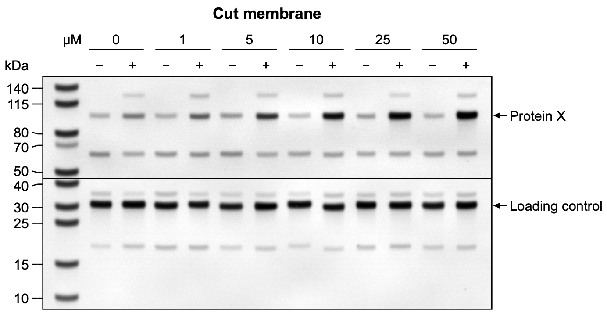

## Before you scan and export

How the pieces are scanned and exported decides how well they line up and how much GelScribe has to change them.

- Scan the pieces with the same settings and in the same orientation. Then the lanes run the same way and have about
  the same spacing in every piece.
- Export each scan at its original pixel size. If your scanner's software resizes images when it exports them, two
  gels come out at different scales and their lanes won't line up. LI-COR Image Studio's export dialog, for one, makes
  every image 1000 pixels wide unless you change the output size. Set it to the original pixel size before exporting
  each one.
- Don't crop before exporting. Crop in GelScribe instead (step 4). Whole scans at the same scale are easier to line
  up, and they keep every lane.
- Use 16-bit TIFF if you want to keep original pixels. GelScribe keeps the bit depth the file has, so with Keep
  original pixels on (step 6) a 16-bit TIFF goes into the figure with its 16-bit values. It can't open 32-bit
  images, integer or floating-point, or CMYK images, and says so when you try.

The two example files are 8-bit PNGs.

## 1. The first gel

Open `top-piece.png` and make its figure as in the main tutorial. This is the gel with the lanes: its lane dividers and
lane labels are the ones every gel uses.

For this gel:

- Straighten (R). It's tilted by 1.3°. GelScribe asks before it turns off Keep original pixels for the rotation.
- Crop (C) to just inside the membrane.
- Brightness and contrast: Auto gives 13–174.
- Lanes (L): 13 of them, the ladder and twelve samples.
- Labels: `µM: |0{−|+}|1{−|+}|5{−|+}|10{−|+}|25{−|+}|50{−|+}` in Quick labels.
- Ladder (K): PageRuler Prestained, NuPAGE Bis-Tris 4–12%, MES. This piece has the top half of the ladder: 140, 115,
  80, 70 and 50 kDa. The 140 and 115 bands are close together, so if a tick doesn't land on the middle of its band,
  hold ⌥ and click the middle.
- Band name (N): Protein X, on the strong band in the last lane, at about 100 kDa between the 115 and 80 kDa bands.

## 2. Add a gel

Choose File › Add Gel…, or Add Gel… in the Gels section of the Figure tab, and pick `bottom-piece.png`. You can pick
several files at once. They go to the bottom of the stack in the order they come in, and you can change the order
later (step 7). GelScribe copies each file into the project, as it did the first image. If a file has the same name as
one already in the project, its copy gets `_1` added to the name, then `_2`, so no copy overwrites another. The gel goes
under the others with a line above it.

Then GelScribe finds the new gel's lanes and lines them up under the lane dividers. This is Auto-align, and the note
under the alignment controls says how well the lanes fit: within 4.4 pixels here, 6% of a lane. To get there it
stretched the gel sideways by 2.50%. Pieces of one membrane don't always come out at exactly the same scale, and here
the bottom piece's lanes are 2.5% farther apart than the top piece's. A new gel starts with Keep original
pixels off, which is what lets it stretch (step 6 has the details). The Original image section above the Gels section
shows one switch for each gel.

The line above the new gel is black and as thick as the figure's other lines. Step 10 changes it.

If Auto-align can't find a gel's lanes, or they don't line up with the first gel's, it says so and leaves the gel where
it is. Step 5 lines a gel up by hand.

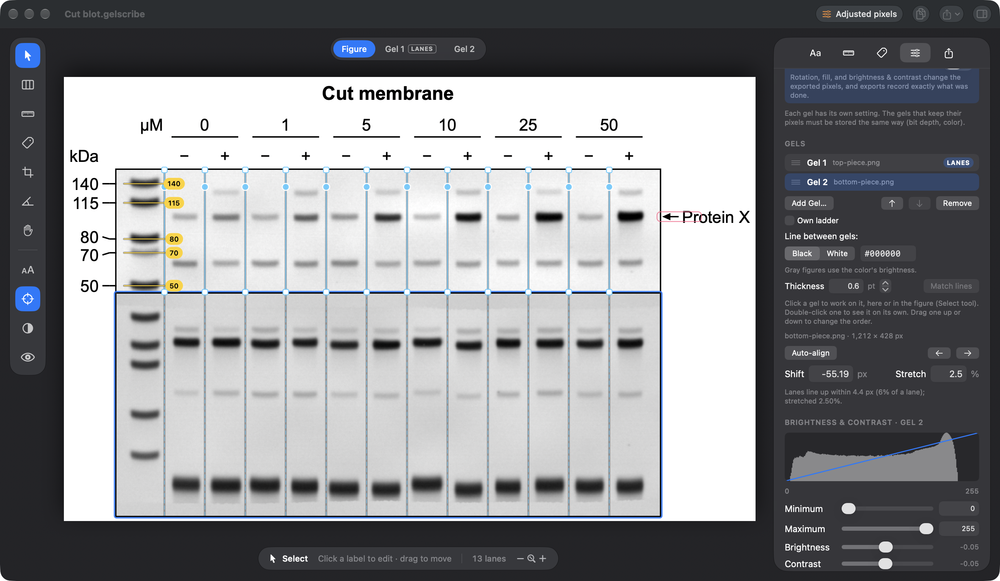

## 3. One gel at a time

Above the canvas is a switcher with Figure, Gel 1 (tagged LANES) and Gel 2. Figure shows the stacked figure. Choosing
Gel 2 shows that gel alone, with its whole scan, and the tools work on it: crop (C), straighten (R), ladder ticks (K)
and band names (N). The brightness and contrast, rotation and crop sections of the Figure tab act on the chosen gel,
and their titles say which one. Gel 1 on its own is the first gel's figure, as it was before you added the others.

The lane dividers belong to the gel with the lanes, so the Lane Dividers tool (L) is off while another gel is on its
own. Choose Figure or Gel 1 to place or move dividers. They continue through Gel 2 as dashed lines, which shows where
its lanes should sit.

You can also choose a gel by clicking its row in the Gels list, or by clicking it in the Figure view with the Select
tool (V): the chosen gel gets a blue outline. With any other tool, a click in the Figure view does that tool's job.
Double-click a gel, in the figure or in the list, to open it on its own.

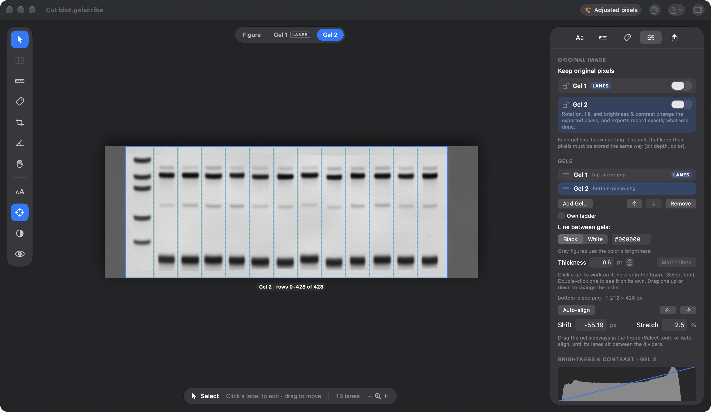

## 4. Cropping a gel

Every gel has a crop of its own, and can be cropped on all four sides. Gel 2's whole scan is in the figure from top to
bottom, dye front included. With Gel 2 chosen, press C. The canvas shows its scan with the part that goes into the
figure outlined. Drag any edge or corner, then press Return to keep the crop, or Esc to put it back. Here the crop is
rows 35–337, which leaves out the dye front. The size shows under the box: 1047 × 302 pixels, columns 67–1114.

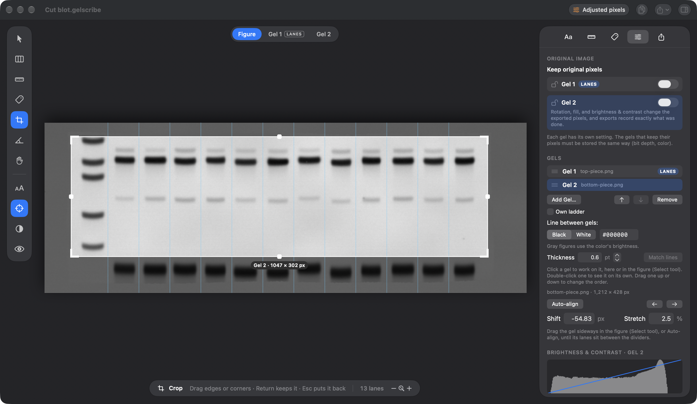

Auto-align looks only at the rows in the figure, so clicking it again after a row crop can improve the fit a little:
within 4.2 pixels here, with the same 2.50% stretch.

A gel you haven't cropped at the sides follows Gel 1's columns: it shows the columns that sit under Gel 1's crop, as
lined up by Auto-align. Dragging a side edge gives Gel 2 columns of its own, which stay put if you change Gel 1's crop.
Reset, in the Crop section of the Figure tab, clears the gel's crop on all four sides: the whole scan again, with Gel
1's columns.

The figure runs from the leftmost to the rightmost column that any gel keeps, and where a gel has no pixels the figure
is blank white. In the picture below Gel 2's crop takes in the whole width of its scan. That is wider than Gel 1's, so
the figure becomes wider and Gel 1 has white on both sides. Undo with ⌘Z before you go on.

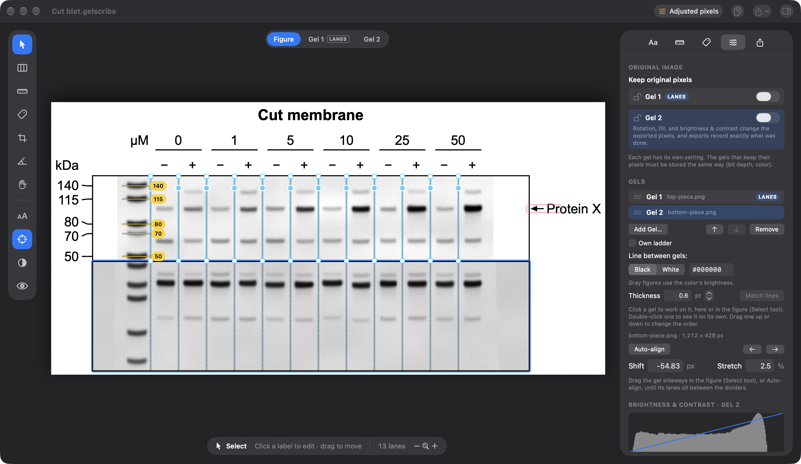

## 5. Lining up by hand

Auto-align is a suggestion. To adjust it, or to line up a gel whose lanes it can't find:

- In the Figure view, drag the gel sideways with the Select tool (V). The lane dividers continue through every gel as
  dashed lines, and the gel's lanes should sit between them. The gel takes its crop with it, so the figure's width can
  change.
- With nothing selected, ← and → move the chosen gel by one pixel, or by ten with ⇧.
- Type a Shift (in pixels) or a Stretch (in percent) in the Gels section. Stretch is off while the gel keeps its
  original pixels.
- Click Auto-align to find the fit again from where the gel is now.

Every gel can move, Gel 1 too. Gel 1 moves in whole pixels and takes its lane dividers, labels, ticks and names along.
Moving a gel never moves another, so use this to line up the edges of Gel 1 with the others. Stretch is only for the
other gels. After moving Gel 1, Auto-align lines a gel up with Gel 1's lanes where they now are, and a gel that follows
Gel 1's crop follows it there.

The picture below has Gel 2 moved by 10 pixels: its lanes no longer sit between the dashed lines, and the Shift field
shows the new value.

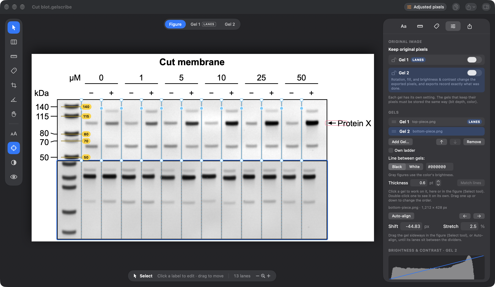

The dashed lines follow the lane dividers. If you move a divider later, check the other gels, or choose Gel 1 and click
Auto-align All, which lines up every other gel under Gel 1's lanes in one step.

## 6. Keep original pixels for each gel

The Figure tab starts with the Original image section, with one Keep original pixels switch for each gel, so you can see
and change all of them whichever gel is chosen. The badge in the toolbar sums them up: Original pixels when every gel
keeps its original pixels, Adjusted pixels when none does, and Mixed otherwise. Clicking the badge takes you to the
switches.

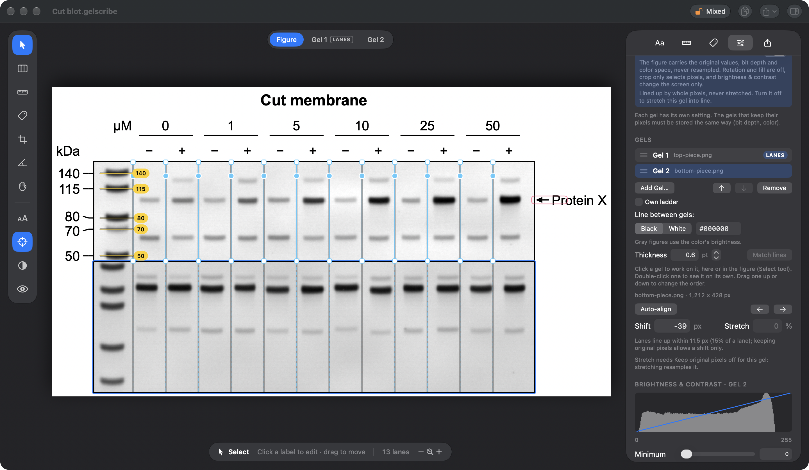

What each choice means for a gel:

- On: the gel's pixel values go into the figure untouched, in the scan's own bit depth and color space. It's lined up
  by whole pixels, never stretched or rotated, and its brightness and contrast change the screen only. Crop and Turn
  only select or move pixels, so they work.
- Off: the gel can be stretched, straightened and moved by fractions of a pixel, and its brightness and contrast go
  into the exported pixels. The export records what was done.

A stretched gel can't keep its original pixels because stretching makes new pixel values between the old ones. The
values in the figure would no longer be the scan's own. That is why a gel you add starts with the switch off, so
Auto-align can stretch it into line. The gel with the lanes starts with it on, and this example turned it off to
straighten the top piece.

The picture above has Gel 2's switch on. Auto-align then shifts it by whole pixels and the lanes fit within 11.5 pixels,
15% of a lane, instead of the 4.2 pixels it got with the stretch. If a whole-pixel fit leaves a lane more than a
quarter of a lane off, the note under Auto-align says by how much, and that turning the switch off for that gel would
stretch it into line.

When every gel keeps its pixels, they must all be stored the same way, with the same bit depth and color (all 8-bit
gray, for example). If they aren't, the Figure tab says so, and exports wait until you turn the switch off for one of
them. When only some do, the figure is stored like the ones that keep their pixels, and those go in untouched. Each
other gel is drawn with its stretch, rotation and display range, as 8-bit gray, and converted to that storage: to gray
by luminance, and for 16-bit multiplied by 257. In the finished figure here both switches are off, because the top
piece is straightened and Gel 2 is stretched.

## 7. Changing the order

Drag a gel up or down in the Gels list, or choose it and use the arrow buttons under the list. Each gel takes its
ticks, names and settings with it. Gels are numbered from the top, so the numbers change when you move one. The gel
with the lanes keeps its LANES tag wherever it goes.

## 8. Ladder ticks and band names on each gel

Press K and click Gel 2's ladder bands from the top down, in the figure or with Gel 2 on its own. Each tick belongs to
the gel you click in, and the sizes carry on from the gel above: after 50 on Gel 1, the first band on Gel 2 is offered
40, then 30, 25, 15 and 10. The Ladder tab lists each gel's ticks under its name, with y in that gel's own pixels.

Carrying on is right for pieces of one membrane. If a gel was run with its own full ladder, choose it and tick Own
ladder in the Gels section: its sizes then start again from the top of the ladder. The box is off for the top gel,
because that gel starts the ladder.

Band names work the same way. Press N, click the strong band in the last lane of Gel 2, at about 30 kDa, and type
Loading control.

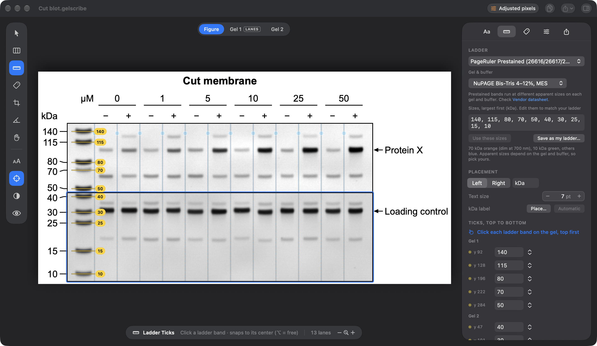

## 9. Brightness, contrast and rotation for each gel

Each scan has its own exposure and background, so each gel has its own brightness and contrast. The top piece's
membrane came out darker than the bottom one's, and you set Gel 1's range in step 1 (Auto, 13–174). Choose Gel 2 and
click Auto: 13–224. The two backgrounds are now close.

Rotation works the same way. A gel scanned at a slight angle is straightened on its own: choose it and press R. A gel
scanned the other way round can be turned by 90° or 180° with Turn, in the Rotate section, and GelScribe lines the gel
up again afterwards. A quarter turn clears that gel's crop, ticks and names, because its lanes then run the other way.

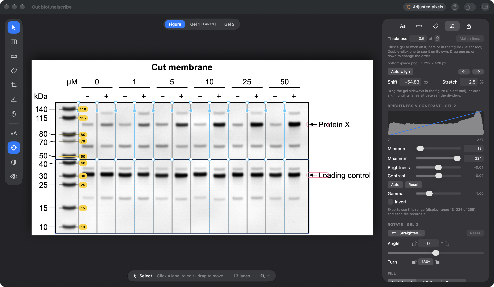

## 10. The line between gels

The line between two gels is black and as thick as the figure's other lines (Lines, under Layout in the Figure tab)
until you change it. Line between gels, in the Gels section, has a Black button, a White button and a field for any
other color as #RRGGBB. A gray figure uses the color's brightness. Thickness sets the width in points, from 0.25 to
10, and Match lines goes back to the figure's line width and follows it from then on. The line is part of every export.

The picture below has a #cc0000 line, 3 points thick.

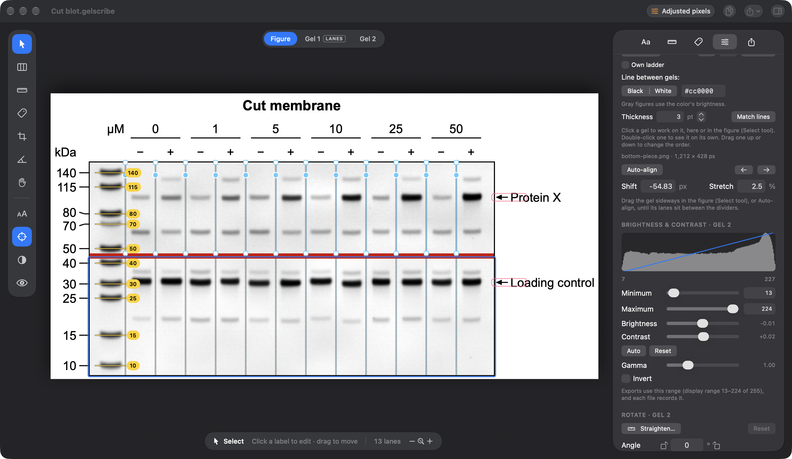

## 11. Labels at an angle

The lane labels sit above the first gel and serve every gel below it. When they're long, set their angle in the Aa tab:
type any angle in Angle, under Quick labels, or click 0°, 45° or 90°. At 45° each label starts above its lane and rises
to the right. The rows above move up to make room, and row titles stay level. Group labels, the ones over several lanes,
have their own Angle in each group row's card under Row by row, and their underline stays level.

For this picture the lane labels were changed to Sample A and Sample B, and both angles are 45°.

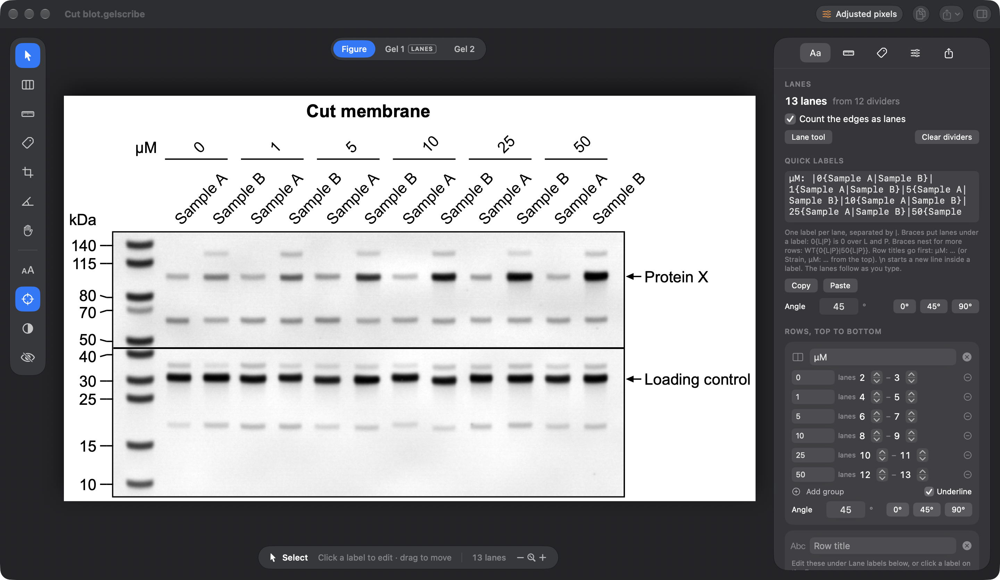

## 12. Export

Exports work as for a single gel. The provenance note lists every gel from the top: what was done to the gel with the
lanes, as before, then each other gel with its file name, SHA-256, the columns and rows it keeps, shift, stretch and
display range. The line under it checks every image against the fingerprint taken when it was added.

When some gels keep their original pixels and others don't, the note's first line says the figure is mixed, and each
gel's entry says which it is. If an image in the project has changed since it was added, the note starts with a
warning and GelScribe asks before exporting. To leave the file names out of exported files, turn off "Include file
names in exported files" in the Export tab; the fingerprints stay either way.

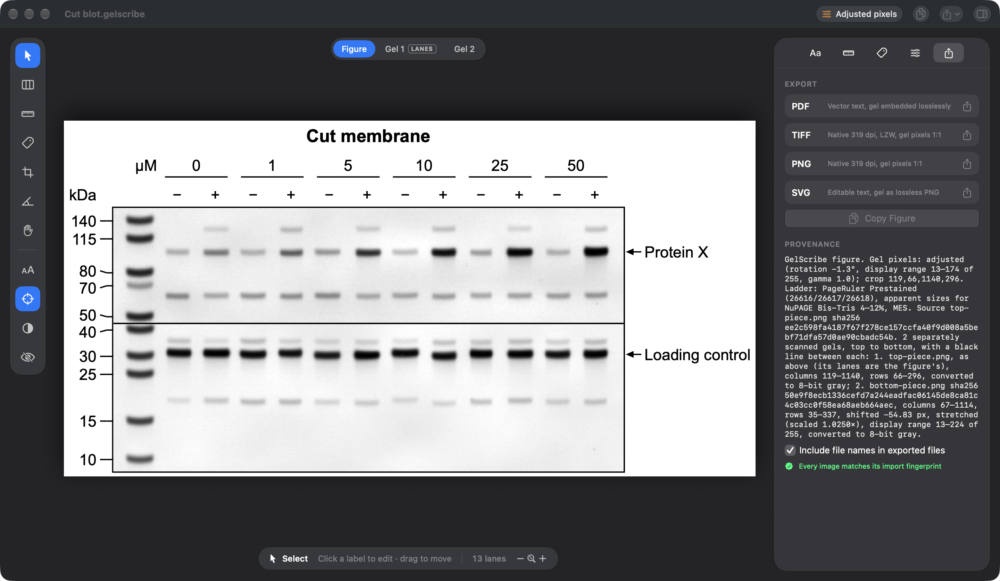

## Starting with several images

Dropping several images on an empty window, or choosing several with Choose Image…, opens the first and stacks the
others under it, in the order they come in. Gel 1 is then chosen and the Lane Dividers tool is on. Place the lane
dividers on it, then click Auto-align All in the Gels section. Each gel's own steps (crop, brightness and contrast, ticks
and names) work as above.

## Removing a gel

Remove, under the Gels list, takes the chosen gel out along with its ticks and names, and ⌘Z puts it back. The gel
with the lanes can't be removed.

The gels' images are copied into the project next to the first image, unchanged. Versions of GelScribe from before
stacked gels open such a project with the first gel only, put the other gels' ticks and names on it, and drop the other
gels when saving, so keep everyone who works on the project up to date.

## Command line

The same figure, apart from brightness and contrast, from the command-line tool (the same in both versions):

```bash
gelscribe new top-piece.png -o "Cut blot.gelscribe"
gelscribe edit "Cut blot.gelscribe" --strict off --rotate -1.3 --auto-lanes 13 --crop 119,66,1140,296 \
  --labels "µM: |0{−|+}|1{−|+}|5{−|+}|10{−|+}|25{−|+}|50{−|+}" \
  --preset thermo-pageruler-prestained --system bt-4-12-mes --no-snap --ticks 92,128,196,222,284 \
  --name "Protein X@154" --title "Cut membrane"
gelscribe edit "Cut blot.gelscribe" --add-gel bottom-piece.png --gel 2 --rows 35,337 --align auto \
  --no-snap --ticks 47,101,138,234,313 --name "Loading control@97"
gelscribe render "Cut blot.gelscribe" --formats pdf,png
```

`--gel N`, counted from the top, aims `--crop`, `--rows`, `--align`, `--shift`, `--scale`, `--ticks`, `--name`,
`--rotate`, `--turn`, `--strict on|off` and `--own-ladder on|off` at that gel; positions are in its own pixels. Without
`--gel`, `--shift PX` moves the gel with the lanes sideways, and `--strict` and `--own-ladder` are about that gel. A gel
added with `--add-gel` starts with `--strict off`, so `--align auto` can stretch it into line.

Cropping, ordering and the other settings from steps 4, 7, 10 and 11:

```bash
gelscribe edit "Cut blot.gelscribe" --gel 2 --crop 0,35,1212,337   # all four sides of gel 2
gelscribe edit "Cut blot.gelscribe" --gel 2 --rows 35,337          # its rows only
gelscribe edit "Cut blot.gelscribe" --gel 2 --shift -54.83 --scale 1.025
gelscribe edit "Cut blot.gelscribe" --gel 2 --strict on --align auto
gelscribe edit "Cut blot.gelscribe" --gel 2 --own-ladder on
gelscribe edit "Cut blot.gelscribe" --separator "#cc0000" --separator-width 3
gelscribe edit "Cut blot.gelscribe" --label-angle 45 --group-angle 45
gelscribe edit "Cut blot.gelscribe" --order 2,1
```

With `--gel N`, `--crop X0,Y0,X1,Y1` sets all four edges of that gel's crop, which gives it columns of its own.
`--rows Y0,Y1` sets just its rows and leaves its columns as they are: following Gel 1's crop, unless you gave it columns
of its own. `--order 2,1` stacks the gels in a new order, and the numbers change with it. `--remove-gel N` takes one
out. `--separator black|white|#RRGGBB` and `--separator-width PT` set the line between gels. `--label-angle DEG` and
`--group-angle DEG` set the angle of the lane labels and of every row of group labels, from 0 to 360. `gelscribe help`
lists the rest.

---

Parts of this tutorial were written with [Claude Code](https://claude.com/claude-code).
