# Tutorial: from scan to figure

This walks through one western blot, from the scanned image to a finished figure, in eleven steps. To follow along,
download [example-blot.png](example-blot.png). It's the 700 nm channel of a blot with a PageRuler Prestained ladder in
lane 1 and eleven sample lanes, run on a NuPAGE Bis-Tris 4–12% gel in MES buffer. Everything in the example is made
up: `make-examples.py`, in this folder, draws the scan, and the labels, concentrations and protein name are invented
too.

The screenshots are from the Mac app in dark mode, which is the default. There's a light mode too, shown at the
[end](#dark-or-light). The Python version (for Windows, Linux, and Intel or older Macs) has the same tools and
tabs; on Windows and Linux, use Ctrl where this page says ⌘, and Alt where it says ⌥.

This is where it ends up:

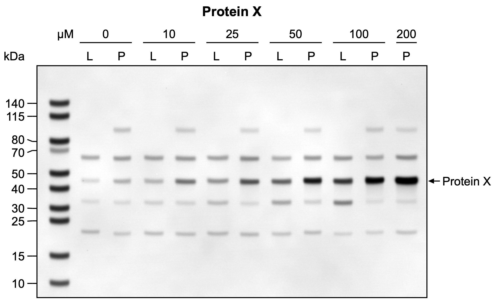

## 1. Open the scan

Drag `example-blot.png` onto an empty GelScribe window, or use the Choose Image button. GelScribe copies the file into
a new project and never changes the original.

The toolbar says Original pixels. That's the Keep original pixels switch, which is on in every new project: the gel
goes into the figure with the scan's own pixel values, and nothing you do on screen changes the data you export. The
switch is at the top of the Figure tab, under Original image, and clicking the badge takes you there. The title above
the figure comes from the file name for now; you'll replace it in step 9.

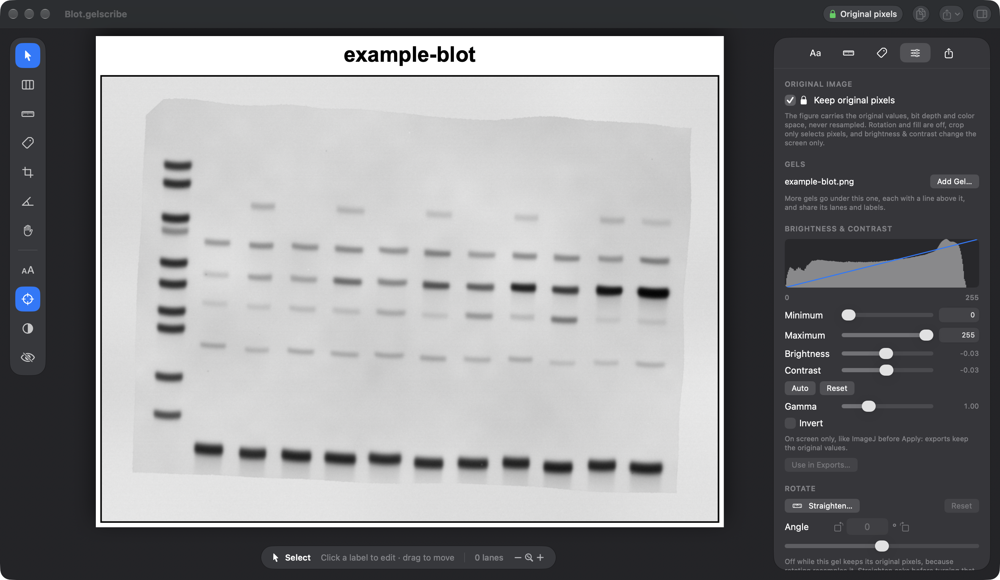

## 2. Straighten (R)

The band row falls to the right by about two and a half degrees. Press R and drag along the row of dark bands, from
the second lane to the last. When you let go, the image turns so that your line is level.

Turning the image means resampling it, so GelScribe asks before it turns Keep original pixels off. Once it's off, the
toolbar says Adjusted pixels and every export records what was done to the gel. The Figure tab opens to show the angle,
2.4° here. You can type a different value there, or click Reset to undo the rotation. For a scan made upside down or
on its side, Turn, just below the angle, makes a half or quarter turn. That only moves pixels, so it works with Keep
original pixels on.

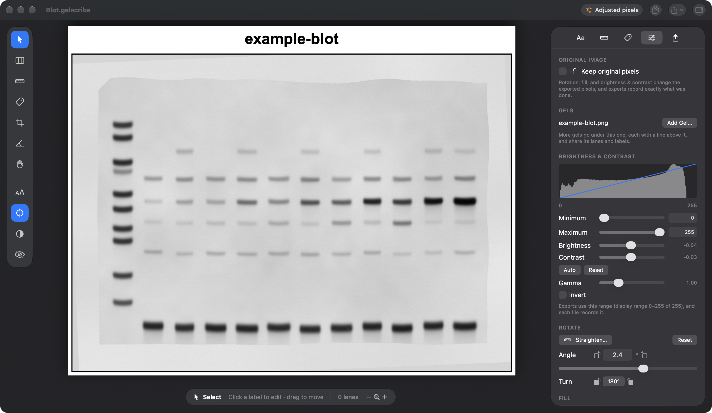

## 3. Crop (C)

Press C. The whole image is shown with the crop box over it. Drag the edges or corners to just inside the gel, leaving
out the uneven top edge and the dye front at the bottom, and press Return. The size shows under the box: 1588 × 945
pixels here.

A crop only selects pixels, so it's allowed with Keep original pixels on too.

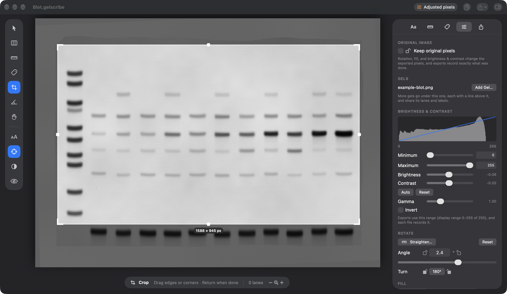

## 4. Brightness and contrast

The background of this scan is light gray rather than white, and the weaker bands are hard to see. Click the
half-filled circle in the tool palette, or press ⇧⌘B, to go to Brightness & Contrast in the Figure tab.

It works like ImageJ's. The histogram shows the gel's pixel values and the blue line shows how they're mapped to the
screen. Minimum and Maximum set the display range, and values outside it are clipped to black or white. Brightness and
Contrast move the same range, and Gamma and Invert are below them.

Click Auto. It sets the darkest 0.1% of the gel to black and the brightest 0.1% to white, which gives 19–224 for this
blot: the background turns white and the weaker bands stand out. Reset goes back to the full 0–255. If ImageJ
saved a display range in the file, a third button applies that range.

What reaches the export depends on Keep original pixels. While it's on, brightness and contrast change only the screen,
as in ImageJ before you press Apply, and Use in Exports… asks before turning it off. This project turned it off when it
was straightened, so its exports use the range and record it in each file.

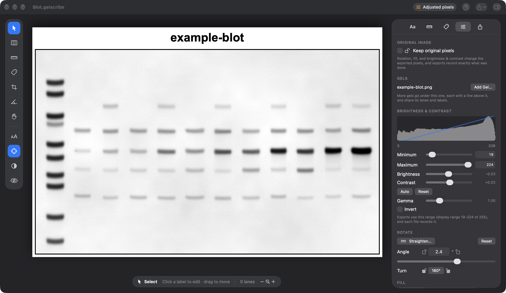

## 5. Lanes (L)

Press L and click once in each gap between two lanes. This blot has 12 lanes, so that's 11 clicks. Each lane gets a
number as soon as it exists. The strips before the first divider and after the last one count as lanes. If your gel
has empty space at the sides, turn off "Count the edges as lanes" in the Aa tab.

If a lane leans, drag either end of its divider. ⌥-click a divider to remove it.

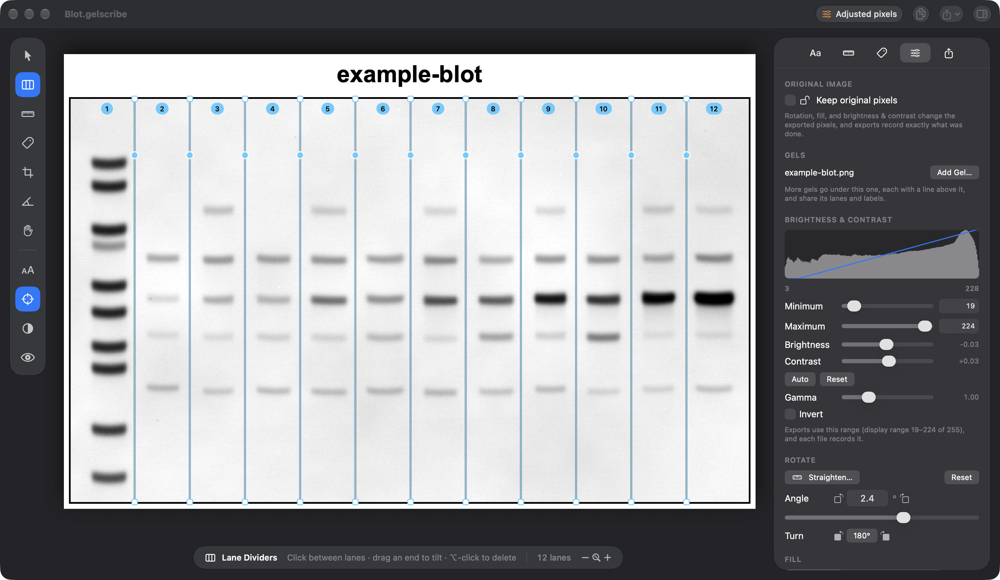

## 6. Lane labels

This blot gets two rows of labels: L or P over each sample lane, and a concentration over each pair, with µM as the
title of that row. The ladder lane stays blank. There are three places to enter labels. All three edit the same
labels, so you can switch between them at any point.

### Quick labels

The fastest way is one line in Quick labels, in the Aa tab:

```
µM: |0{L|P}|10{L|P}|25{L|P}|50{L|P}|100{L|P}|200{P}
```

Each entry between two `|` is one lane, from left to right. The empty first entry leaves lane 1, the ladder, without a
label. `0{L|P}` puts 0 over two lanes labeled L and P, and `µM:` names that row. The figure follows as you type.
[Label notation](../README.md#label-notation) in the README has more examples.

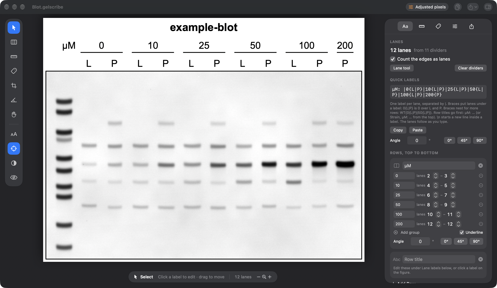

Long lane labels can be set at an angle so they don't run into each other. Type any angle in Angle, under Quick
labels, or click 0°, 45° or 90°. At 45° each label starts above its lane and rises to the right, at 90° it reads from
bottom to top, and at 270° it reads from top to bottom and ends just above its lane. The rows above move up to make
room, and row titles stay level. Group labels turn too: each group row has its own Angle in its card under Row by row,
and its underline stays level. In this picture the lane labels are Sample A and Sample B instead of L and P, and both
angles are 45°.

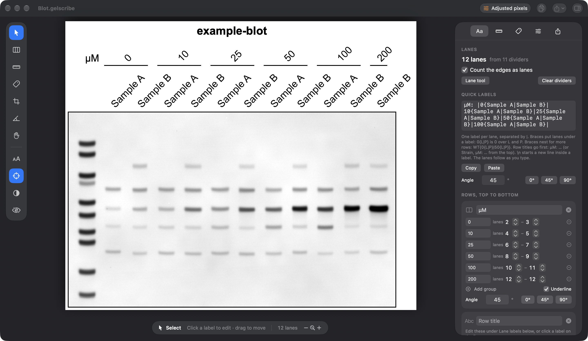

### Row by row

Under Quick labels, the same labels are laid out one field at a time. This is the way to go if you'd rather not learn
the notation, or need to fix one entry.

Rows, top to bottom, has a card for each row of labels above the gel. The concentrations are a group row: each group
has its text and the first and last lane it covers. The arrows change those lanes, the minus button removes the group,
and Add group adds one over the two lanes after the last group. Underline turns the lines under the groups on or off.
Each group row's card also has an Angle, with 0°, 45° and 90° buttons, for turning the group labels (see above). The
second card is the row of lane labels, which you edit in the list further down. Add Row, under the cards, adds another
row of either kind.

Lane labels has one field per lane. To label a gel this way from the start, type L or P into each lane's field. Then
choose Add Row › Group Row, type µM as the row title, and click Add group once for each concentration, typing the
number into each group. The first group covers lanes 1–2, so set it to 2–3; each group after that takes the next two
lanes.

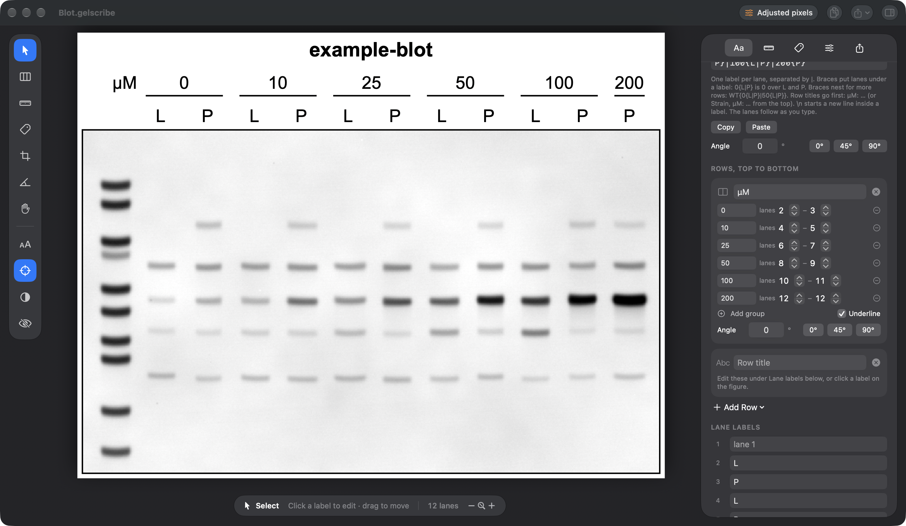

### On the figure

Any label can also be edited where it is. With the Select tool (V), click a label on the figure, change the text and
press Return. The editor has a size that applies to that label only, and ⌘↩ starts a second line. Here the 10 over
lanes 4 and 5 is open:

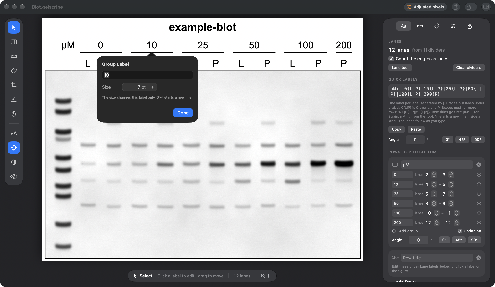

## 7. Ladder (K)

In the Ladder tab, choose the ladder, PageRuler Prestained (26616/26617/26618), and then the gel and buffer it ran in,
NuPAGE Bis-Tris 4–12%, MES. Prestained markers run at different apparent sizes in different gels and buffers, so the
size list follows that choice: 140, 115, 80, 70, 50, 40, 30, 25, 15 and 10 kDa. If your datasheet says otherwise, edit
the list and click Use these sizes.

Then press K and click the ladder bands from the top down. Each click snaps to the middle of the band (hold ⌥ to place
it exactly where you click, or turn snapping off with the crosshair button in the tool palette), takes the next size
from the list and opens a small editor beside the ladder lane. Press Return to accept the size, or pick another one.
Sizes you haven't confirmed keep a question mark. Confirm all, at the bottom of the Ladder tab, accepts them all at
once.

On this blot, 70 is the faint band just below 80. The dark bands below the 10 kDa band, in the sample lanes of the
uncropped scan, are the dye front, which the crop in step 3 left out.

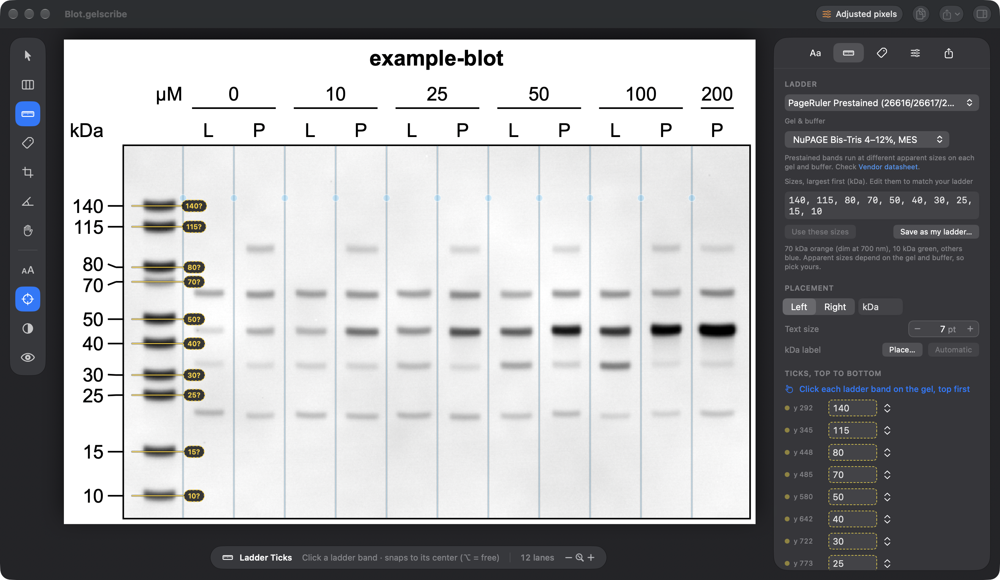

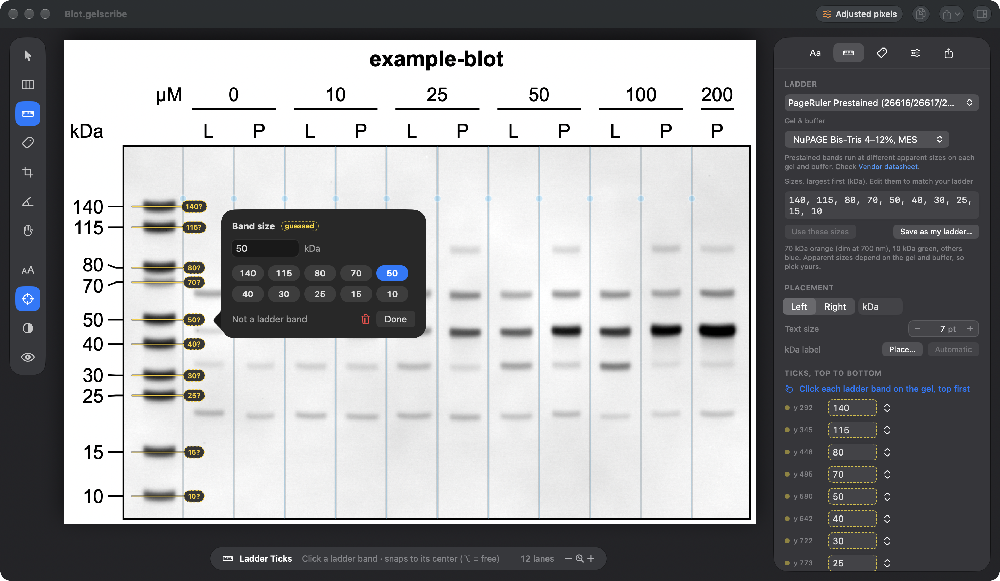

## 8. Band names (N)

Press N and click the band you want to name, in the lane next to the edge of the gel: here, the strong band in the last
lane, between the 50 and 40 kDa ladder bands. The click snaps to the band and opens the name editor. Type the name,
Protein X here, choose how it points at the band (an arrow, a tick, a bracket or just the text) and press Return.

Names you've typed before are listed under Recent. The Names tab shows every name on the figure, with its marker, side
and text size.

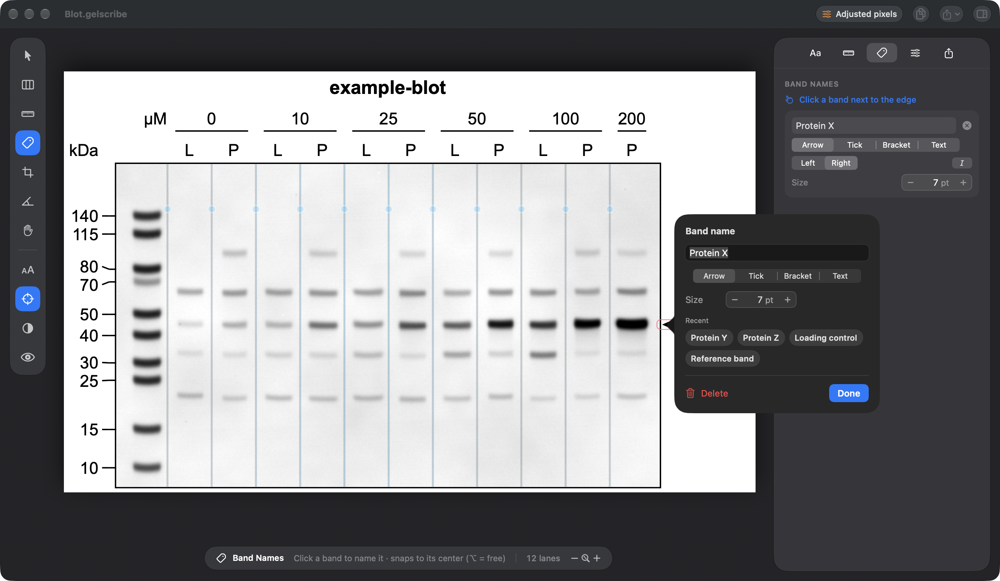

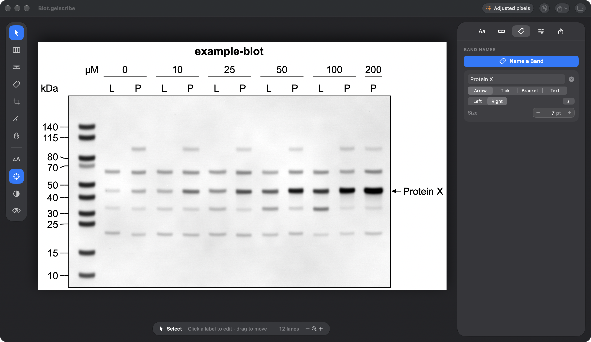

## 9. Title and text sizes

Click the title on the figure and type a new one, Protein X here, the same way as the labels in step 6.

The Aa tab has the title too, and a text size for each kind of label. The two A buttons next to All text, or ⇧⌘− and
⇧⌘=, make all the text smaller or bigger.

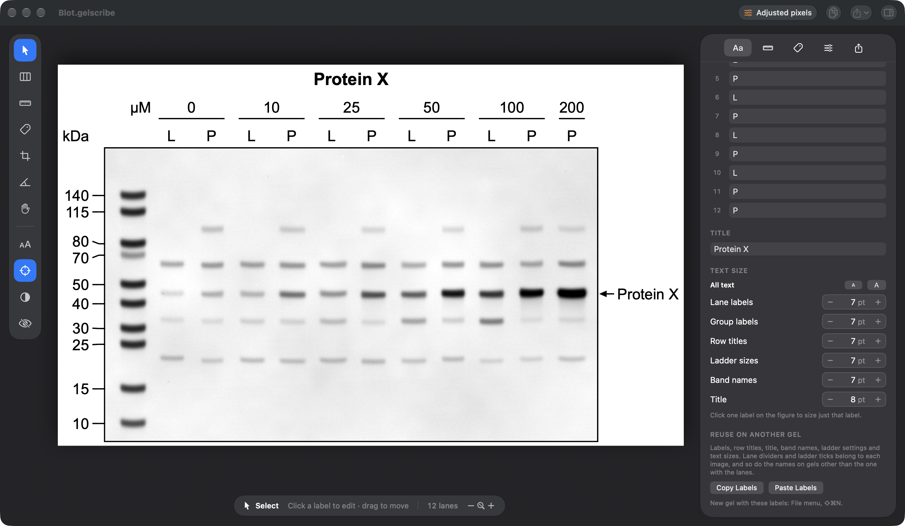

## 10. Figure settings

The Figure tab has everything that changes the image or the layout:

- Original image: the Keep original pixels switch, with a note on what it currently allows. In a multi-gel figure there
  is one switch for each gel.
- Gels, where more gels are added (see the end of this page).
- Brightness and contrast, from step 4.
- Rotate: the angle, and Turn for a quarter or half turn.
- Fill, for the corners a rotation uncovers: the measured gel background, white, or a gray you choose.
- Crop, including Fit to Lanes, which crops around the lane dividers.
- The font, the gel's width on the page, line width, tick length and an optional border.

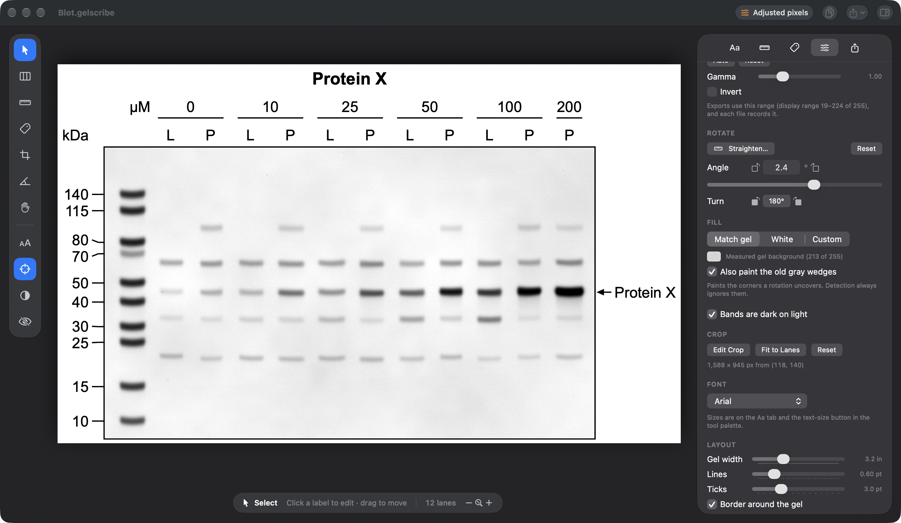

## 11. Export

Export from the Export tab or the Export menu:

- PDF keeps the text as text and embeds the gel without loss.
- TIFF and PNG are written at the gel's own resolution, 496 dpi for this figure, so each gel pixel is one pixel in the
  file. Export › PNG and TIFF Resolution can resample to 300, 600 or 1200 dpi instead.
- SVG keeps the text editable in Illustrator or Inkscape, with the gel inside as a lossless PNG.

Copy Figure (⇧⌘C) puts the figure on the clipboard as both PDF and PNG.

Under Provenance is the note written into every exported file: what was done to the gel (here the rotation and the
display range from step 4), the crop, the ladder with its gel and buffer, and the SHA-256 of the original image. The
line below it says whether the image in the project still matches that fingerprint. File names can identify samples or
people, so if yours do, turn off "Include file names in exported files" in the Export tab (`--file-names off` on the
command line); the fingerprints stay either way.

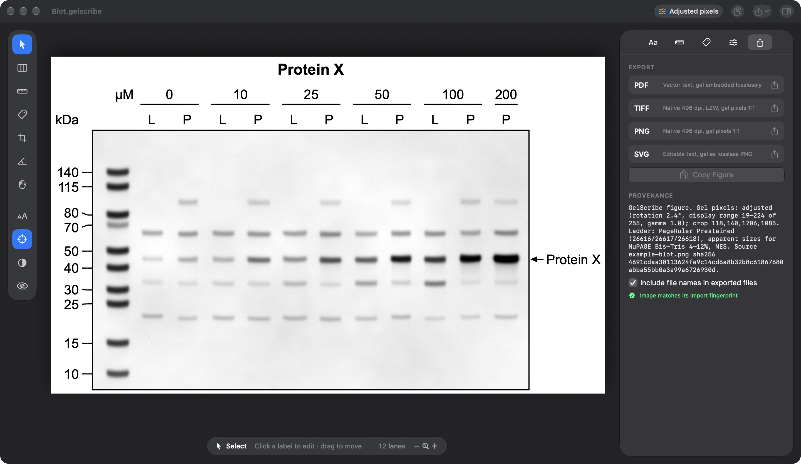

## The next gel

File › New Gel with These Labels (⇧⌘N) asks for the next image and starts a project with this one's labels, row
titles, title, band names, ladder and text sizes. Lane dividers and ladder ticks belong to each image, so you place
those again. Copy Labels and Paste Labels in the Edit menu do the same between two open projects.

## More than one gel

To stack several scans under the same lanes, such as the pieces of a cut membrane or a loading control from a second
gel, add them with File › Add Gel…. Each gel then has its own crop, brightness and contrast, ladder ticks, band names
and Keep original pixels switch, and the toolbar badge can read Mixed. See the
[tutorial for multi-gel figures](multi-gel.md), which starts with how to scan and export the pieces.

## Dark or light

GelScribe opens in dark mode. View › Appearance switches between Dark and Light, in both versions, and the app
remembers the choice. Only the window changes: the figure is drawn on white in both, and exports are the same.

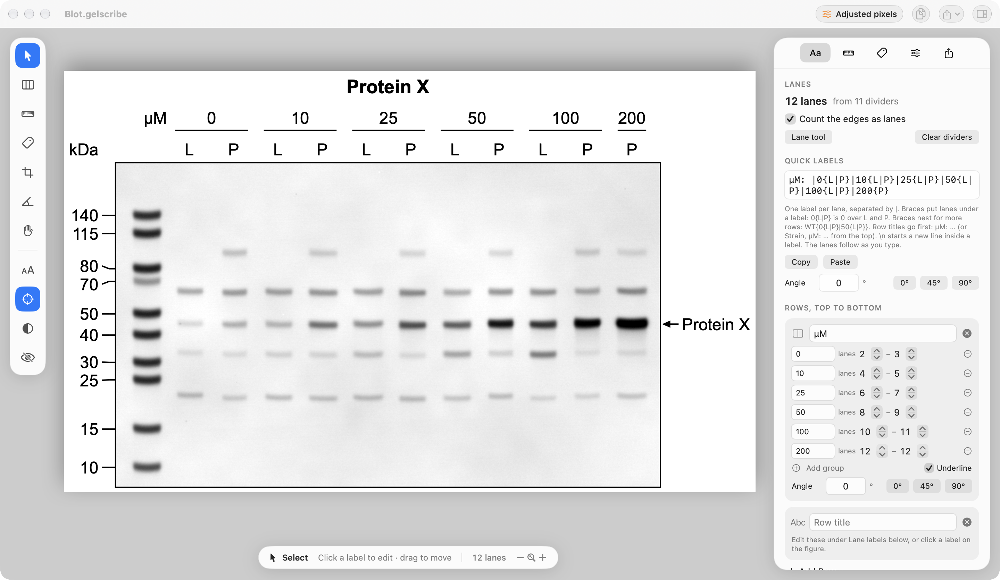

---

Parts of this tutorial were written with [Claude Code](https://claude.com/claude-code).
